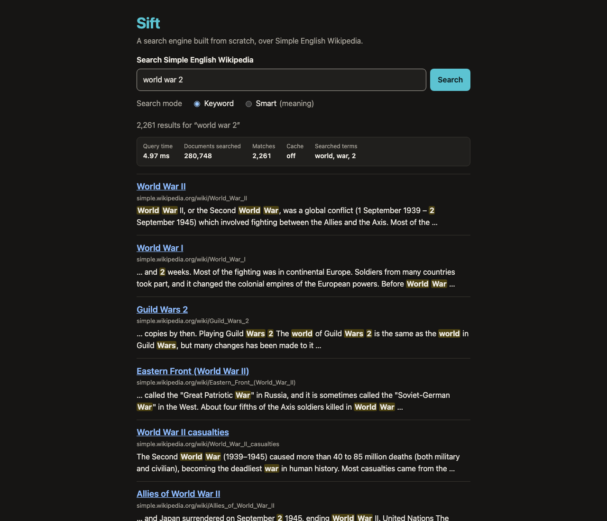
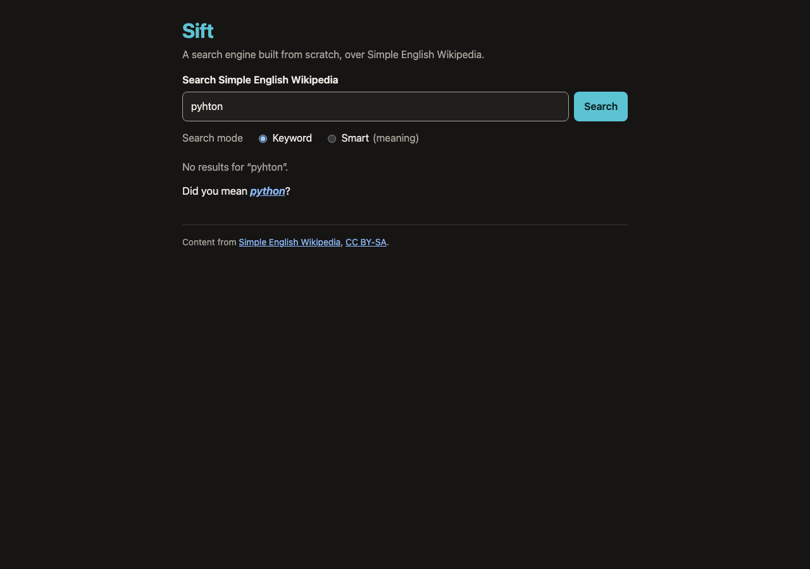
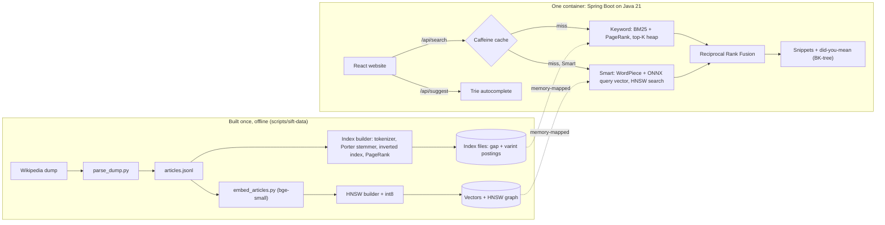

# Sift

**A search engine I built from scratch: 280,748 Simple English Wikipedia articles, keyword and meaning
search, answers in about 6 ms.**

**Live demo:** _coming soon (link added after deployment)_  ·  Demo GIF: _coming soon_

| Search results | "Did you mean" | Phone |
| --- | --- | --- |
|  |  |  |

## What it does
- **Search box with autocomplete**: suggestions after one letter (a trie of titles).
- **"Did you mean…?"**: spelling correction with edit distance and a BK-tree.
- **Two modes**:
  - **Keyword**: BM25 + PageRank.
  - **Smart** (the default): keyword results fused with meaning search, so "how do plants make food" finds
    *Photosynthesis* (#2).
- **Results**: highlighted snippets (the best 30-word window), pagination, and a stats panel (time, documents
  searched, cache hit or miss).

## Results (measured, not estimated)
All numbers come from real runs on an Apple M5 laptop. Every one is in [`eval/results/final-summary.md`](eval/results/final-summary.md)
with the raw file it came from.

| | Baseline BM25 | Final keyword | Final Smart |
| --- | --- | --- | --- |
| MRR, 30 held-out queries (never tuned on, run once) | 0.305 | 0.774 | **0.857** |
| hit@3, held-out | 15/30 | 24/30 | **29/30** |
| MRR, 50 main queries (used for tuning, so optimistic) | 0.275 | 0.868 | 0.956 |

| Speed and size | Value |
| --- | --- |
| Query time over HTTP, p95 (no cache) | keyword 6.1 ms, Smart 13.0 ms |
| Repeated query (cache hit) | 0.006 ms in the server, ~0.65 ms over HTTP |
| Load test, 10 users, no cache (k6, 60 s) | keyword 1,663 req/s (p95 23 ms), Smart 386 req/s (p95 54 ms), 0 errors |
| Spelling correction | 12 of 15 typos fixed |
| Posting lists, plain → gap + varint | 364 MB → 112 MB |
| Meaning vectors, float32 → int8 | 411 MB → 104 MB (recall 0.986) |
| Container | 553 MB compressed, starts in 2.3 s, runs in < 1 GiB of memory |

## Architecture


## What I built myself
Every search algorithm is my own Java code, with JUnit tests (264 tests):
- **Text**: tokenizer (one class shared by indexing and queries), Porter stemmer, BERT WordPiece tokenizer
  (matches the model's own tokenizer on 1,000 / 1,000 test strings).
- **Index**: inverted index with positions, posting-list intersection (two pointers), gap + varint compression,
  memory-mapped binary files.
- **Ranking**: BM25 (and a BM25F variant), PageRank, top-K min-heap.
- **Typing help**: trie with the top 5 completions stored in each node, edit distance (dynamic programming),
  BK-tree.
- **Meaning search**: cosine similarity, brute-force search, **HNSW** (graph build, search, save and load), int8
  quantisation, Reciprocal Rank Fusion.
- **Evaluation**: MRR and hit@k tools, pre-registered experiments, held-out query sets.

Libraries only do the plumbing:
- Spring Boot (web server), Jackson (JSON), Caffeine (cache).
- ONNX Runtime (runs the neural network; tokenizing, pooling and search around it are mine).
- React + Vite (website), JUnit / Vitest (tests), k6 (load tests).
- Python with sentence-transformers, used offline only: it embeds the articles once and exports the model.

Key decisions and their numbers are in [DESIGN.md](DESIGN.md). How every part works, explained simply, is in
[docs/learning/](docs/learning/).

## Run it locally (3 commands)
Needs Git, Python 3.11+, Docker, and a JDK to start Gradle (Gradle downloads Java 21 itself if needed).
```bash
git clone https://github.com/gopal089/sift.git && cd sift
```
```bash
scripts/sift-data
```
```bash
docker build -t sift . && docker run -p 8080:8080 sift
```
Then open http://localhost:8080.
- `scripts/sift-data` downloads the Wikipedia dump and builds the index, embeddings and graph. It runs once: about
  25 minutes on an Apple M5, longer without a GPU.
- Without Docker: run `cd web && npm ci && npm run build && cd ..`, then `scripts/sift-api`.
- For development: `scripts/sift-api` + `cd web && npm run dev`.

## Credits
Article text comes from [Simple English Wikipedia](https://simple.wikipedia.org) (dump of 2026-11-01), licensed
under [CC BY-SA 4.0](https://creativecommons.org/licenses/by-sa/4.0/). Search results link back to the original
articles. The meaning model is [BAAI/bge-small-en-v1.5](https://huggingface.co/BAAI/bge-small-en-v1.5) (MIT license).
