# Sift website — two design directions

Step 1 of the redesign. Pick one; nothing in `web/` has changed yet.

## How these were made
- Each direction is a static prototype in `docs/design/prototypes/<direction>/` (`home.html`, `results.html`,
  `style.css`). The results page uses one **real** API response: `how do plants make food`, Smart mode, from the
  running server (184 results, 30.2 ms, cache miss). Nothing on the pages is made up.
- Screenshots were taken with headless Chrome at a real 1280 px and 375 px viewport (375 px uses mobile
  emulation), in light mode, plus one dark-mode shot per direction. They are in `docs/design/screenshots/`.
- Contrast ratios use the WCAG 2 formula. Normal text needs 4.5:1. Borders that show where a field is need 3:1.
- Both directions use **system fonts only**. Nothing is downloaded, so text never jumps when a font arrives
  (no layout shift) and no new dependency is needed.
- Neither has gradients, shadows, glows, emoji, pill buttons or cards. Every CSS value in the prototypes comes
  from a token at the top of its `style.css`.

## The current site (before)
| Home, 1280 | Results, 1280 | Home, 375 | Results, 375 |
| --- | --- | --- | --- |
| 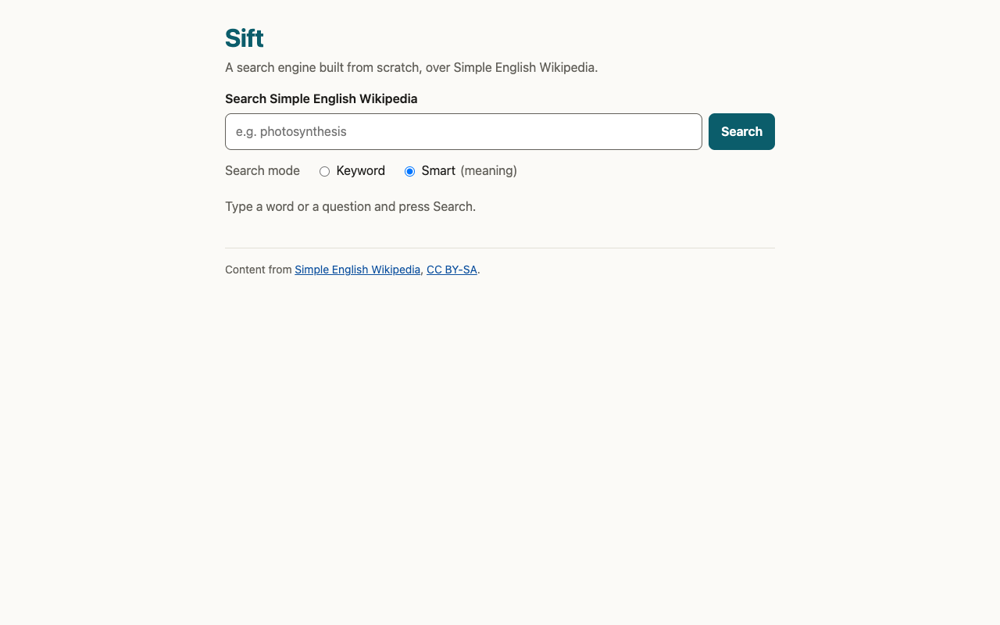 | 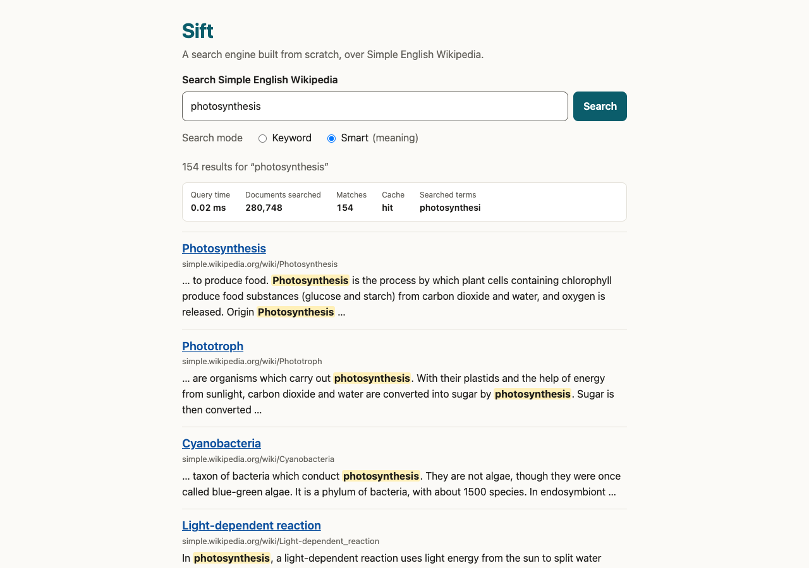 | 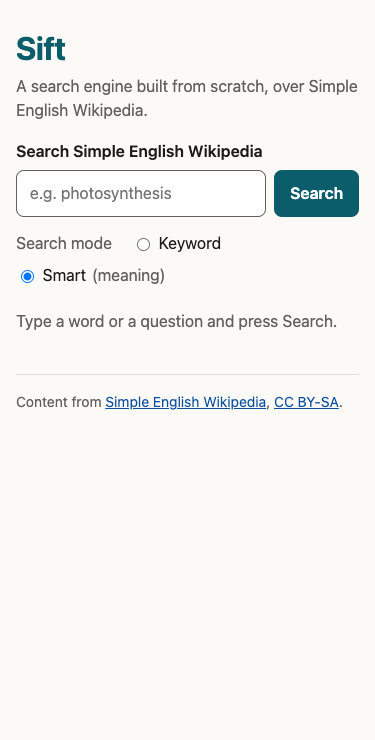 | 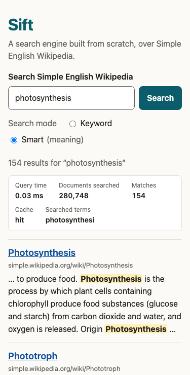 |

What holds it back:
- Everything has the same weight. The tagline, label, radios, stats box and results all look alike.
- The stats box sits above the results and is the loudest thing on the page.
- Plain radio buttons for the mode, and a filled teal button, look like a default template.
- The home page is a form with nothing to start from.

---

## Direction A — "Reference"
**The idea:** it should feel like looking something up in a well-set reference book. The article text is the
star; the interface around it is quiet.

- **Serif for reading, sans for the controls.** Titles and snippets are set in a serif (the text you read). The
  search box, mode switch and numbers are in the system sans (the parts you operate). The two jobs look different.
- **One column, one left edge.** The search box, the result titles and the pager all start on the same line.
  The wordmark sits in its own gutter to the left. Your eye runs straight down the titles.
- **Whitespace instead of lines.** Results are separated by 32 px of space, not boxes or rules.
- **Stats are one quiet line**: `184 results · 30.2 ms · Details`. The full numbers (model time, vector time,
  documents searched, cache, terms) open under "Details".
- **The mode is a pair of text tabs** (Smart / Keyword) with a one-line note saying what the chosen mode does.
- **Warm paper and ink**: an off-white page, near-black text, one ink-blue for links, a pale ochre behind the
  matched words, like a highlighter pen.

| Home, 1280 | Results, 1280 | Results, dark, 1280 |
| --- | --- | --- |
| 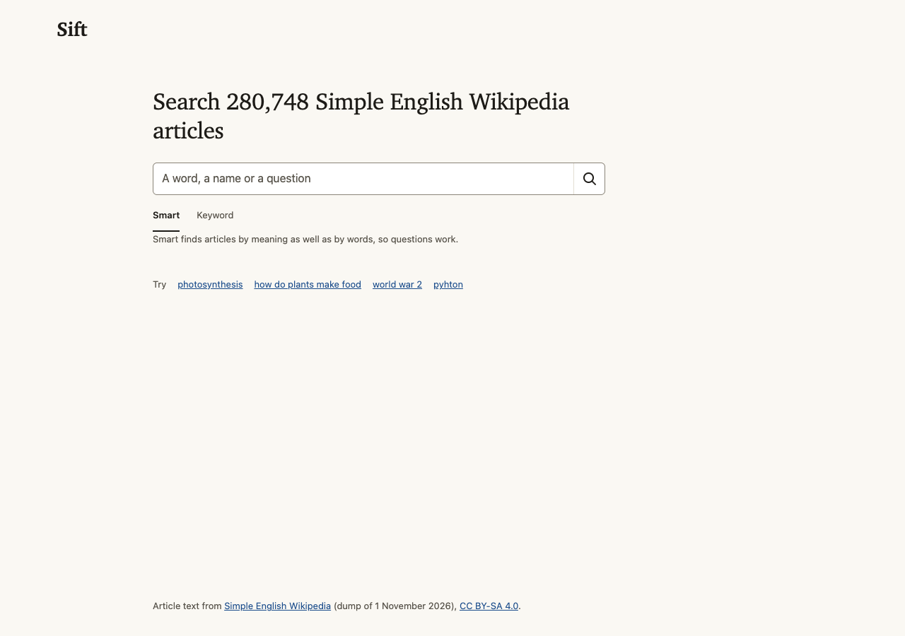 | 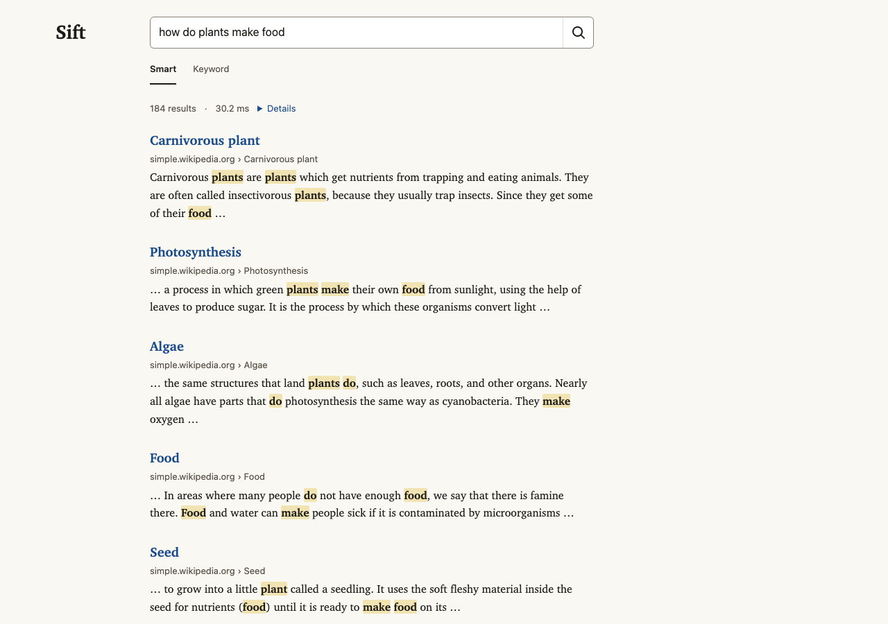 | 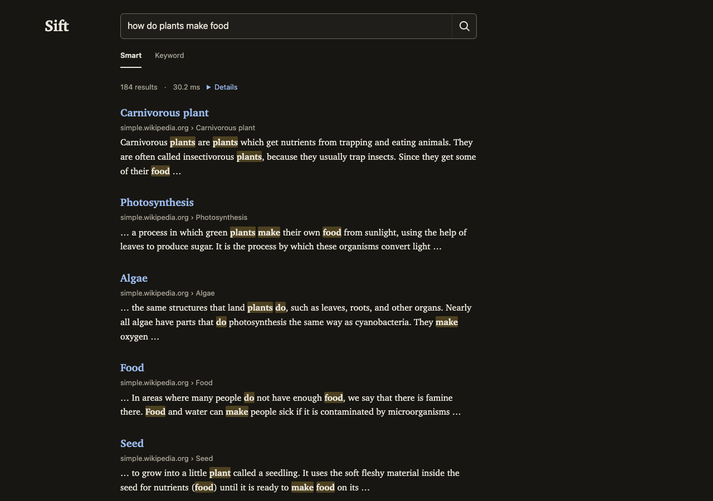 |

| Home, 375 | Results, 375 | Home, dark, 375 |
| --- | --- | --- |
| 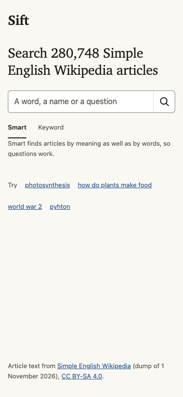 | 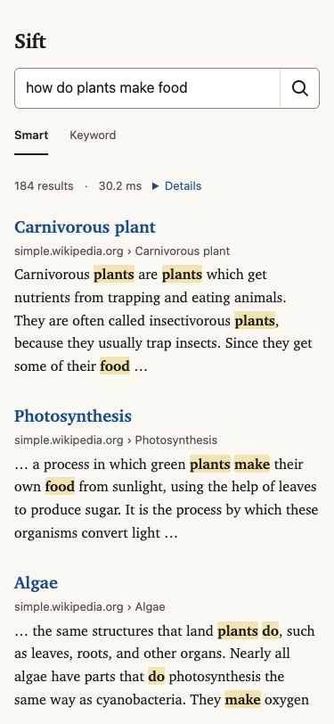 | 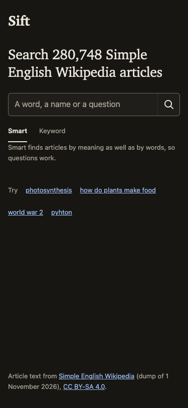 |

### Type
Two families:
- **Serif:** `Charter, "Bitstream Charter", "Sitka Text", Cambria, "Noto Serif", Georgia, serif`. Charter ships on
  macOS and iOS, Sitka and Cambria on Windows, and Noto Serif on Android.
- **Sans:** `system-ui, -apple-system, "Segoe UI", Roboto, "Noto Sans", sans-serif`.

The scale uses a ratio of 1.2 (each step is 1.2× the one before) from a base of 16 px:

| Token | Size | Used for |
| --- | --- | --- |
| `--step--1` | 13 px (0.8125rem) | source line, stats, mode tabs, footer |
| `--step-0` | 16 px (1rem) | snippets, input text (16 px stops iOS from zooming in on focus) |
| `--step-1` | 19 px (1.1875rem) | result titles |
| `--step-2` | 23 px (1.4375rem) | wordmark on phones |
| `--step-3` | 28 px (1.75rem) | wordmark; home heading on phones |
| `--step-4` | 33 px (2.0625rem) | home heading |

- Line height is 1.6 for reading and 1.25 for titles.
- Weights are 400 and 600.

### Colour (light / dark)
| Use | Light | Ratio | Dark | Ratio |
| --- | --- | --- | --- | --- |
| Body text | `#1d1b17` on `#faf8f3` | 16.2:1 | `#eae6dc` on `#171612` | 14.5:1 |
| Secondary text | `#57534a` on `#faf8f3` | 7.2:1 | `#a8a296` on `#171612` | 7.1:1 |
| Placeholder in the field | `#57534a` on `#ffffff` | 7.7:1 | `#a8a296` on `#201e1a` | 6.6:1 |
| Links and titles | `#1a4c8b` on `#faf8f3` | 8.1:1 | `#9cbcf0` on `#171612` | 9.4:1 |
| Highlighted word | `#1d1b17` on `#f2e3b3` | 13.4:1 | `#eae6dc` on `#4d4120` | 8.1:1 |
| Error text | `#9b2c1f` on `#faf8f3` | 7.1:1 | `#f0a493` on `#171612` | 9.0:1 |
| Field border (needs 3:1) | `#8a8478` on `#faf8f3` | 3.5:1 | `#6f6a60` on `#171612` | 3.4:1 |

- Hairline rules use `#e3ded3` in light and `#33302a` in dark. They are decorative only.
- The dark theme is warm charcoal, not pure black. The ochre highlight becomes a dark olive so the matched words
  stay readable.

### Spacing and shape
- **Spacing**, on a 4 px base: 4, 8, 12, 16, 24, 32, 48, 64 px (`--space-1` … `--space-8`).
- **Radius**: 2 px for the highlight and 6 px for the field and buttons.
- **Layout**: the reading column is 40rem (about 70 characters per line), with a 136 px wordmark gutter. Every tap
  target is at least 44 px.

---

## Direction B — "Catalogue"
**The idea:** a precise tool, like a library catalogue or a terminal. It is ordered and dense, and the numbers
are part of the design.

- **One sans for everything, plus a monospace for data.** URLs, rank numbers and stats are in a monospace with
  even-width digits, so numbers line up in columns.
- **A fixed top bar** holds the wordmark, the search box, a Search button and a two-part mode switch. The rest of
  the page is results.
- **Numbered results** (`01`, `02`…) in a narrow gutter, separated by thin rules like rows in an index.
- **A right-hand rail** shows the search numbers as a small table: total, model and vector time, documents
  searched, matches, cache, terms. On phones it shrinks to one line (`30.2 ms · cache miss · details`) above the
  results.
- **The home page explains itself**: example searches and two plain sentences on what Smart and Keyword do. The
  rail shows facts about the index (articles, source, dump date).
- **Cool and neutral**, with one deep green for links and the Search button. Matched words are bold on a pale
  green.

| Home, 1280 | Results, 1280 | Results, dark, 1280 |
| --- | --- | --- |
| 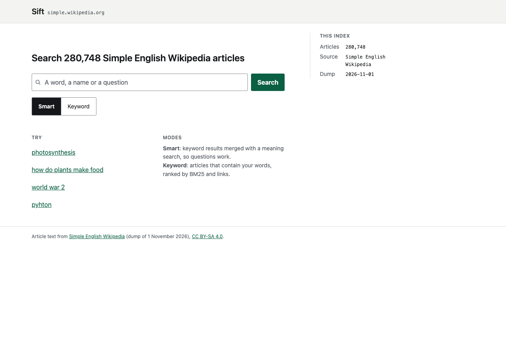 | 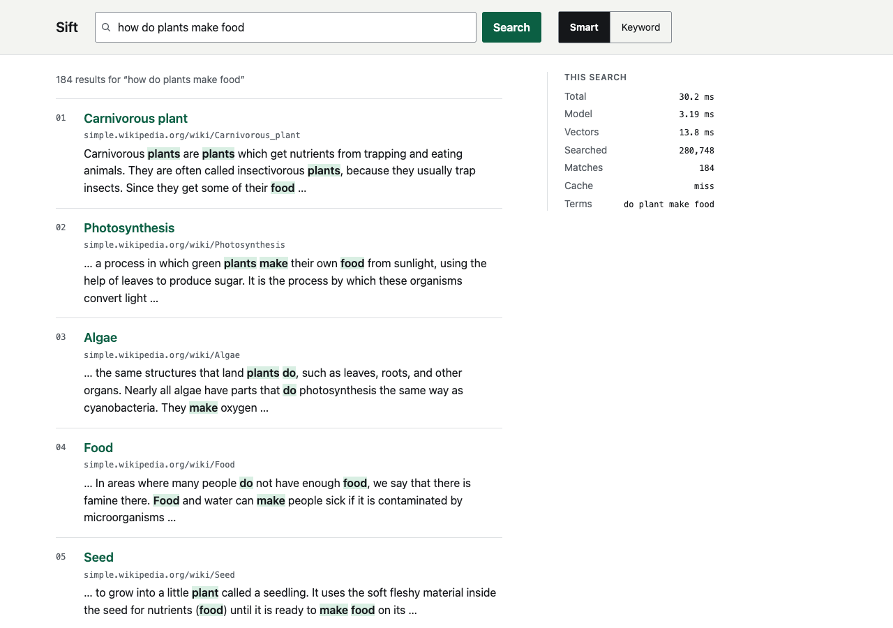 | 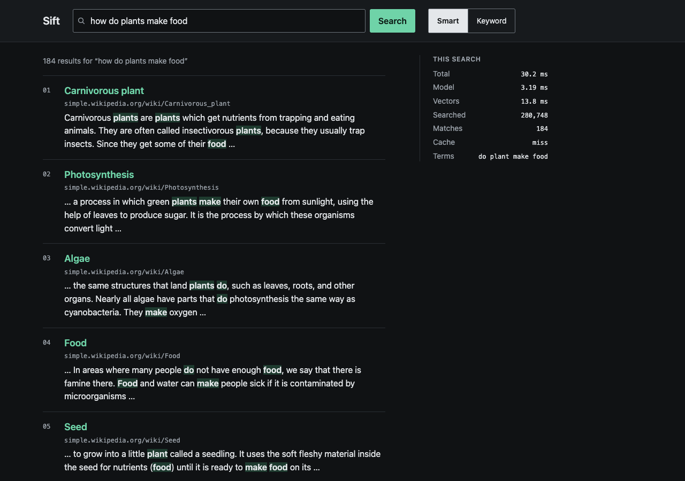 |

| Home, 375 | Results, 375 | Home, dark, 375 |
| --- | --- | --- |
| 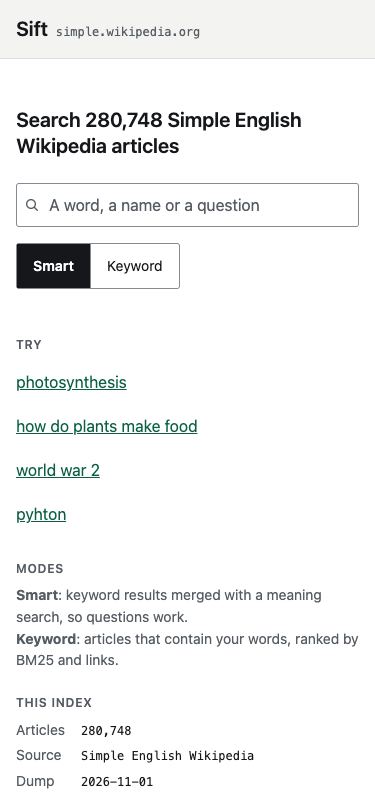 | 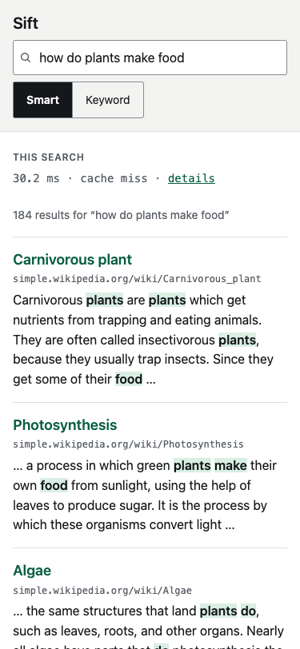 | 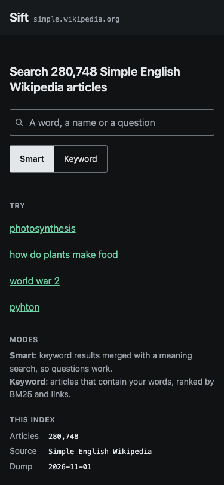 |

### Type
Two families:
- **Sans:** `system-ui, -apple-system, "Segoe UI", Roboto, "Noto Sans", sans-serif`.
- **Mono:** `ui-monospace, "SF Mono", Menlo, Consolas, "Roboto Mono", monospace`.

The scale uses a ratio of about 1.125, from a base of 16 px:

| Token | Size | Used for |
| --- | --- | --- |
| `--step--2` | 12 px (0.75rem) | rank numbers, URLs, stats values, section labels (uppercase), footer |
| `--step--1` | 14 px (0.875rem) | result count, mode switch, rail labels |
| `--step-0` | 16 px (1rem) | snippets, input text |
| `--step-1` | 18 px (1.125rem) | result titles |
| `--step-2` | 20 px (1.25rem) | wordmark; home heading on phones |
| `--step-3` | 24 px (1.5rem) | home heading |

- Line height is 1.55 for reading and 1.3 for titles.
- Weights are 400 and 600.

### Colour (light / dark)
| Use | Light | Ratio | Dark | Ratio |
| --- | --- | --- | --- | --- |
| Body text | `#15171a` on `#ffffff` | 18.0:1 | `#e4e7ea` on `#101214` | 15.1:1 |
| Secondary text | `#565c63` on `#ffffff` | 6.8:1 | `#9ba2aa` on `#101214` | 7.3:1 |
| Secondary text on the top bar | `#565c63` on `#f3f4f1` | 6.1:1 | `#9ba2aa` on `#171a1d` | 6.8:1 |
| Links and titles | `#0b5f43` on `#ffffff` | 7.7:1 | `#6fd3a8` on `#101214` | 10.3:1 |
| Highlighted word | `#15171a` on `#d9efe3` | 14.9:1 | `#e4e7ea` on `#1e3b2f` | 9.8:1 |
| Search button label | `#ffffff` on `#0b5f43` | 7.7:1 | `#0b1a14` on `#6fd3a8` | 9.9:1 |
| Selected mode label | `#ffffff` on `#15171a` | 18.0:1 | `#101214` on `#e4e7ea` | 15.1:1 |
| Error text | `#a3261b` on `#ffffff` | 7.4:1 | `#ff9f94` on `#101214` | 9.5:1 |
| Field border (needs 3:1) | `#858b92` on `#ffffff` | 3.4:1 | `#6b7279` on `#101214` | 3.9:1 |
| Field border on the top bar (needs 3:1) | `#858b92` on `#f3f4f1` | 3.1:1 | `#6b7279` on `#171a1d` | 3.6:1 |

- Rules use `#dcdfe2` in light and `#2a2f34` in dark.
- The dark theme is a cool near-black. The green gets lighter so links keep a 10:1 contrast.

### Spacing and shape
- **Spacing**, on an 8-point grid with a 4 px half step: 4, 8, 16, 24, 32, 48, 64 px (`--s-1` … `--s-7`).
- **Radius**: one value, 3 px.
- **Layout**: a 40rem results column, a 64 px gap, and a 15rem rail. Below 1024 px the rail moves above the results
  as one line. Below 768 px the rank numbers and the Search button hide (Enter searches, and the field keeps
  its search icon). Every tap target is at least 44 px.

---

## Side by side
| | A — Reference | B — Catalogue |
| --- | --- | --- |
| Feels like | an encyclopaedia page | a precise tool or index |
| Reading | serif snippets, long-form comfort | sans, denser, quicker to skim |
| Stats panel | one quiet line, details on demand | always visible rail on desktop |
| Mode switch | text tabs + a one-line note | two-part segmented switch |
| Home page | a heading, the box, four example searches | heading, box, examples, mode explanations, index facts |
| Risk | can look too plain if spacing is off | the rail and numbers can compete with the results |

## My recommendation: A — Reference
- It fits the brief best: calm, text-first and results-first. The brief also says the stats panel is "small and
  quiet". In A it is one line; in B it is a whole column that pulls the eye away from the results.
- Serif snippets suit encyclopaedia text, and the serif/sans split shows *reading* versus *operating* without any
  colour or boxes.
- It has fewer parts (no top bar, no rail, no rank gutter), so there is less to get wrong on small screens and at
  200% zoom.

B's best idea is the rank numbers and the always-visible numbers. If you like those, I can bring the monospace
numbers into A's "Details" list without the rail.

## What the prototypes do not show yet (they come in Step 2)
Autocomplete open, "Did you mean", no results, error, loading, page 2 and the last page, focus rings, hover
states, and motion. The prototypes are static HTML. Their links do nothing, and they are not the final code.
